# BenchKrasulya 0.14 beta

Уникальный самостоятельный бенчмарк кэшей и оперативной памяти для современных процессоров (Windows 7/8.1/10/11 x64).
Открытый исходный код, всё написано с нуля: C++20 + Win32 API, без сторонних библиотек.

**Скачать:** [BenchKrasulya.exe](https://github.com/GroznyiBombila/BenchKrasulya/releases) — один файл, установка не нужна.

## Особенности

- **Гибридные процессоры.** Тест закрепляется за выбранным логическим CPU, поток не перескакивает между ядрами. Тип ядра (P, E, LP E на SoC-тайле Meteor Lake) определяется через CPUID 1Ah на каждом ядре. Энергосбережение потока (EcoQoS) отключается на время замера.
- **Все уровни кэша.** Размеры L1D/L1I/L2/L3 берутся из Windows для каждого ядра, тест «Кэш» идёт до 8×L3 (до 1 ГБ). Под Hyper-V/VBS, где Windows приписывает E-ядрам кэши P-ядра, размеры уточняются по справочнику Intel.
- **Настоящая ОЗУ, а не L3.** Тесты памяти идут в области в 4+ раза больше всего L3 (128 МБ – 1 ГБ), перед каждым замером кэш вытесняется. Отдельно есть режим «4 МБ» — он показывает, как ведёт себя небольшая область, целиком лежащая в L3.
- **Сведения о памяти.** Тип (DDR/DDR2/DDR3/DDR4/DDR5, LPDDR3/4/5), частота, слоты, число каналов и теоретический пик читаются из SMBIOS.
- **Ширина векторов.** SSE2 / AVX / AVX-512 на выбор (по умолчанию — самая широкая доступная).
- **Пять тестов:** скорость по уровням кэша, задержка (нс и такты), чтение и запись блоками со скачком адреса, многопоточная пропускная способность ОЗУ.
- **Тёмный интерфейс.** Окно, графики и таблицы — в одной тёмной теме, сохранённые PNG выглядят так же. На Windows 10 1809+ тёмные и заголовок окна, и полосы прокрутки.

## Как выглядит

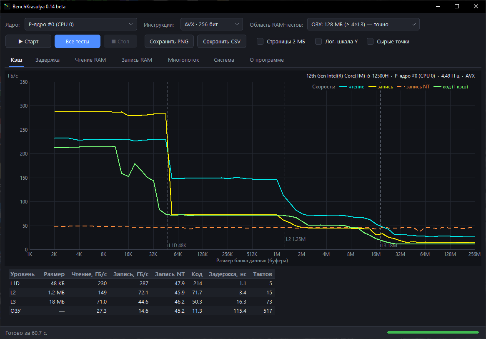

<details>
<summary>Остальные вкладки (i5-12500H, DDR4-3200)</summary>

Идёт прогон «Все тесты»:
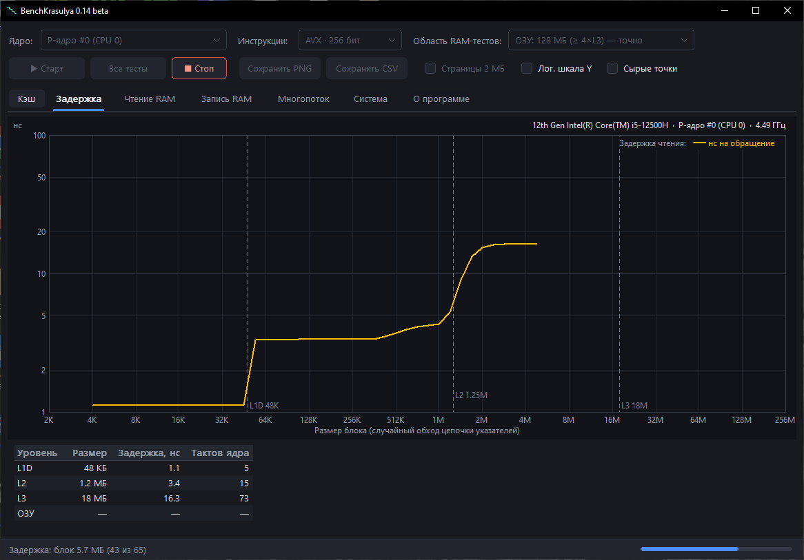

Задержка:
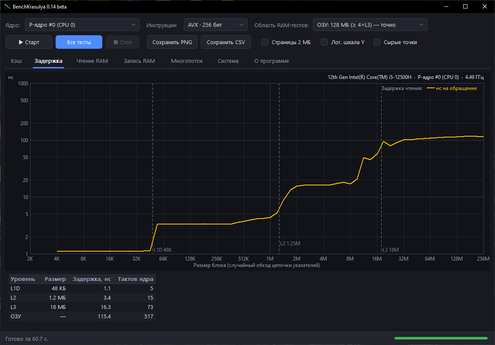

Чтение RAM:
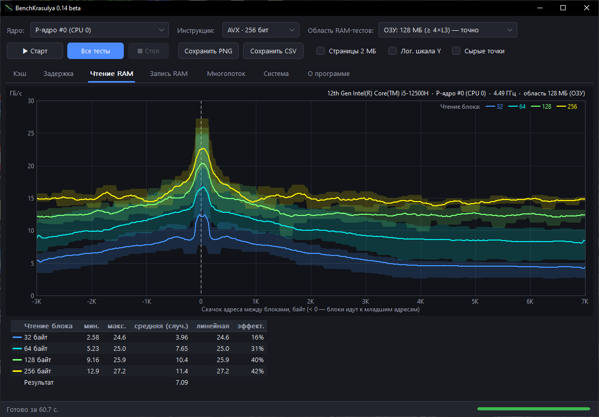

Запись RAM:
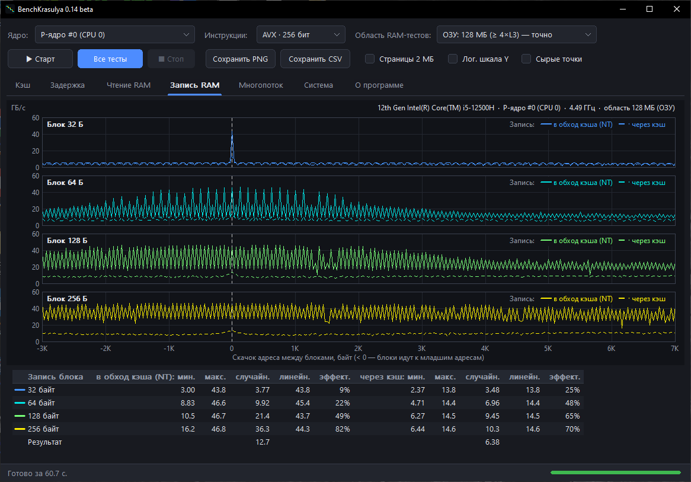

Многопоток:
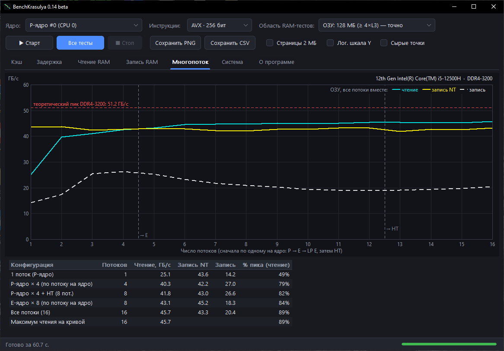

Система:
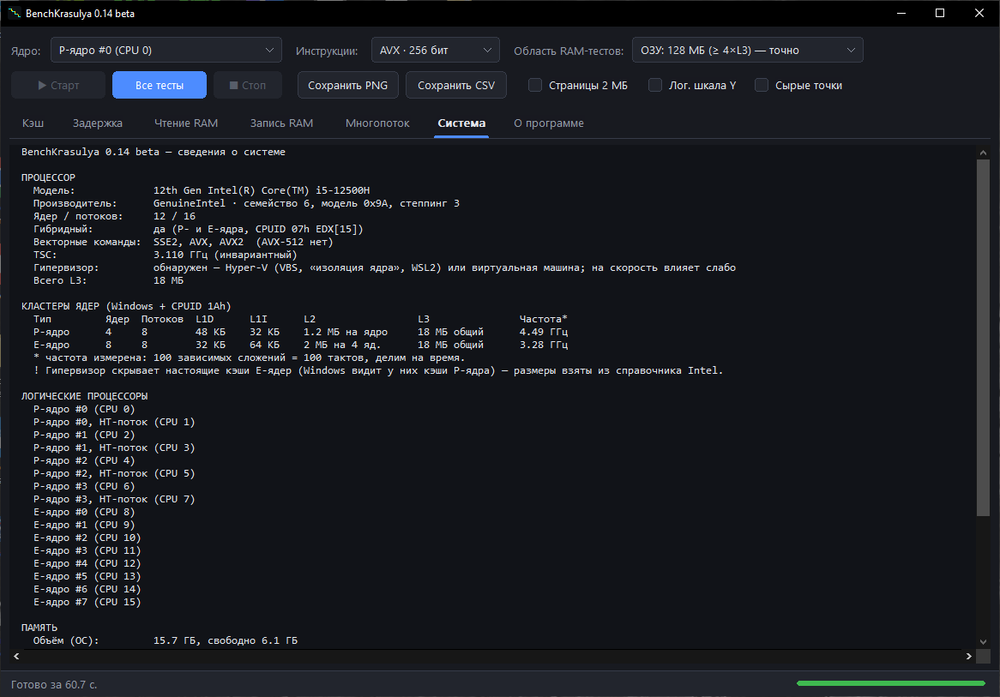

О программе:
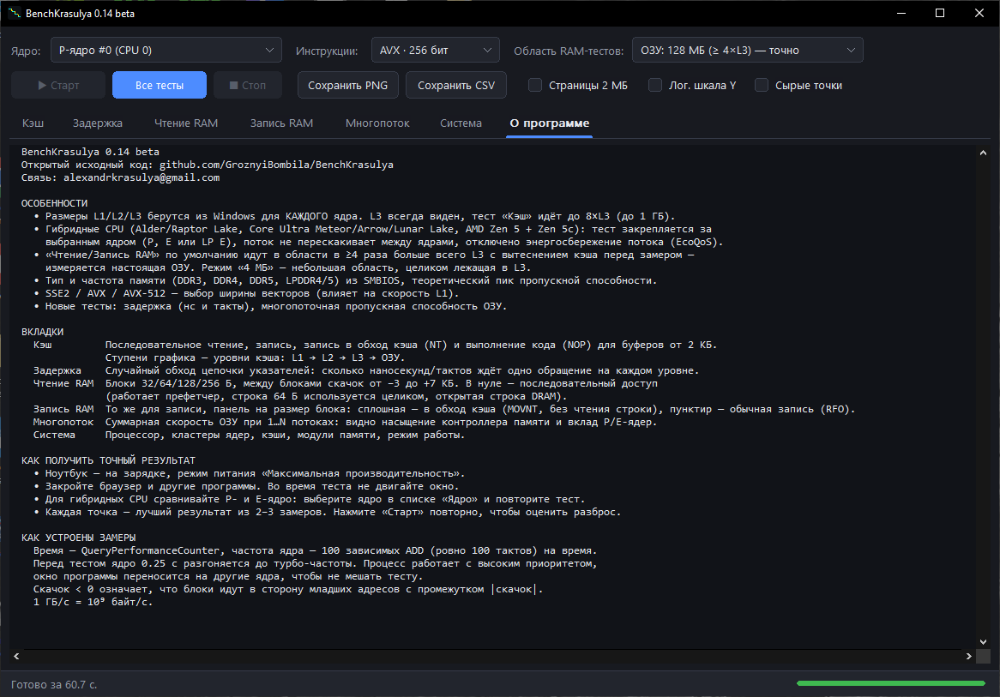

</details>

## Вкладки

- **Кэш** — скорость от размера буфера (2 КБ … 8×L3): чтение, запись, запись в обход кэша (NT) и выполнение кода (поток NOP). Ступени графика — это уровни L1 → L2 → L3 → ОЗУ. Ниже таблица по уровням.
- **Задержка** — случайный обход цепочки указателей (алгоритм Саттоло), результат в нс и в тактах ядра.
- **Чтение RAM / Запись RAM** — блоки 32/64/128/256 Б и скачок между ними. Скачок < 0 означает, что блоки идут к младшим адресам с промежутком |скачок|. Запись — по панели на каждый размер блока, в каждой две линии: в обход кэша (MOVNT, write-combining) и обычная запись через кэш.
- **Многопоток** — суммарная скорость ОЗУ при 1…N потоках: сначала по одному на P-ядро, затем E и LP E, затем HT. Линия теоретического пика.
- **Система** — процессор, кластеры ядер, кэши, частоты, модули памяти.

Результаты сохраняются кнопками «Сохранить PNG» и «Сохранить CSV» (CSV открывается в Excel).

Командная строка: `BenchKrasulya.exe --auto <папка> [--cpu N] [--compat] [--tests clrwm]` прогоняет тесты без участия пользователя и сохраняет в папку PNG, CSV и system.txt. Буквы в `--tests`: c — кэш, l — задержка, r — чтение RAM, w — запись RAM, m — многопоток.

## Как читать результаты

Под таблицами в программе показываются только предупреждения (оранжевым): частота ядра менялась во время теста, включён режим «4 МБ», памяти хватило не на все потоки. Пояснения к вкладкам собраны здесь.

**Кэш.** Значение уровня в таблице — медиана по точкам внутри уровня (до ½ его объёма). Размеры кэшей берутся из Windows для выбранного ядра, поэтому L3 виден всегда. Запись NT идёт в обход кэша (MOVNT) и почти не зависит от размера. «Код» — выполнение цепочки 8-байтных NOP, то есть скорость выборки и декодирования инструкций. Столбец задержки берётся с вкладки «Задержка» для того же ядра.

**Задержка.** Каждая строка кэша (64 Б) хранит адрес следующей, порядок обхода случайный (алгоритм Саттоло), поэтому префетчер не помогает и видна чистая задержка. При больших размерах к задержке ОЗУ добавляются промахи TLB (страницы 4 КБ); галочка «Страницы 2 МБ» их почти убирает (нужно право «Блокировка страниц в памяти»). У DDR5 задержка в наносекундах обычно не ниже, чем у DDR4: частота выше, но и таймингов в тактах больше. Такты = нс × измеренная частота ядра.

**Чтение RAM / Запись RAM.** Блок читается или пишется целиком, затем адрес сдвигается на скачок; 0 — сплошной последовательный доступ. «Средняя» — блоки по случайным адресам, «линейная» — при скачке 0, «эффект.» = средняя / линейная. «Результат» — взвешенная средняя: вес 32 Б наибольший, каждый следующий размер в 1.5 раза меньше. На графике чтения линия — среднее по 8 соседним точкам (256 Б), полупрозрачная полоса — разброс замеров в этом окне; галочка «Сырые точки» показывает замеры как есть. Запись разбита на 4 панели, по одной на размер блока, с общим масштабом по Y; в каждой две линии: сплошная — запись в обход кэша (MOVNT, write-combining), пунктир — обычная запись через кэш (с чтением строки, RFO). Линии — сырые замеры без сглаживания, видны все колебания. В режиме ОЗУ область в 4+ раза больше всего L3, перед каждым замером кэш вытесняется, а повторные проходы сдвигаются на новые строки — поэтому измеряется именно память. В режиме «4 МБ» область на современных CPU целиком лежит в L3, поэтому это тест кэша, а не памяти.

**Многопоток.** Каждый поток закреплён за своим логическим CPU и читает/пишет собственный буфер (первое касание на своём ядре — важно для NUMA). Один поток не может загрузить шину DDR4/DDR5: он упирается в число одновременных промахов (буферы заполнения строк), поэтому скорость растёт с числом потоков до насыщения контроллера памяти. Суммарная скорость = общий объём всех потоков / общее время окна замера. Теоретический пик (красная линия) = МТ/с × ширина шины / 8; формула и число каналов — на вкладке «Система».

## Совместимость

| | Что поддерживается |
|---|---|
| ОС | Windows 7 SP1, 8.1, 10, 11, только 64-битные. Для Windows 7 нужно обновление KB2999226 (Universal CRT) |
| Память | DDR, DDR2, DDR3, DDR4, DDR5, LPDDR3/4/5. Старые BIOS, которые пишут частоту в МГц вместо МТ/с, распознаются и пересчитываются. Если SMBIOS не отдаёт тип памяти, тесты всё равно идут, просто без расчёта теоретического пика |
| Intel | От Core 2 до Core Ultra 100/200 (Meteor Lake, Lunar Lake, Arrow Lake), гибридные 12–14 поколения. P, E и LP E-ядра определяются отдельно. Процессоры без L3 (Core 2) тоже поддерживаются: граница ОЗУ считается по L2 |
| AMD | Athlon 64 / Phenom … Ryzen 9000, включая Zen 4c/Zen 5c и несколько CCD (L3 суммируется) |
| Ядра | Больше 64 логических CPU (группы процессоров Windows) |
| Наборы команд | SSE2 работает везде; AVX и AVX-512 включаются, если процессор и ОС их поддерживают |

Проверено вживую на i5-12500H + DDR4-3200 (Windows 10). Остальные конфигурации проверены эмуляцией (см. «Тестирование») — если на каком-то ПК что-то определится неверно, пришлите system.txt в Issues.

## Как измеряется

- Время берётся из QueryPerformanceCounter. Каждая точка — лучший из 2–3 замеров.
- Частота ядра: 100 зависимых `add reg, reg` занимают ровно 100 тактов. `add reg, imm` не годится: ядра Golden Cove сворачивают такие цепочки, и частота получается в 5–6 раз выше реальной.
- Перед тестом ядро 0.25 с разгоняется до турбо-частоты. Процесс работает с высоким приоритетом, окно программы уводится с тестируемого ядра.
- ГБ/с — десятичные: 10⁹ байт/с.

## Сборка

Нужен MinGW-w64 (g++ x86_64, проверено на GCC 16.1) в `C:\mingw64\bin`. Запустите `build.bat`, на выходе получится `BenchKrasulya.exe`, статически слинкованный.

Файлы:
- `src/sysinfo.*` — CPUID, топология, кэши, SMBIOS;
- `src/kernels_*.cpp` — циклы чтения и записи для SSE2/AVX/AVX-512;
- `src/bench.*` — тесты;
- `src/chart.*` — графики;
- `src/main.cpp` — интерфейс.

## Пример (i5-12500H, DDR4-3200 2×8 ГБ, P-ядро)

| | Чтение | Запись | Задержка |
|---|---|---|---|
| L1D 48 КБ | ~230 ГБ/с | ~287 ГБ/с | 1.1 нс (5 тактов) |
| L2 1.25 МБ | ~149 ГБ/с | ~72 ГБ/с | 3.4 нс (15 тактов) |
| L3 18 МБ | ~71 ГБ/с | ~45 ГБ/с | 16.5 нс (74 такта) |
| ОЗУ, 1 поток | ~27 ГБ/с | ~14.5 ГБ/с (NT 46) | ~115 нс |
| ОЗУ, 16 потоков | 46.1 ГБ/с = 90% от пика 51.2 | | |

Полные результаты этого прогона (PNG всех вкладок, CSV, system.txt) лежат в [examples/i5-12500H](examples/i5-12500H).

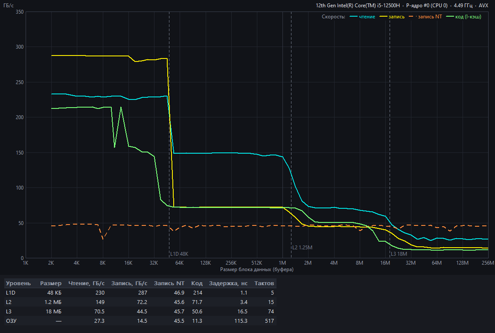
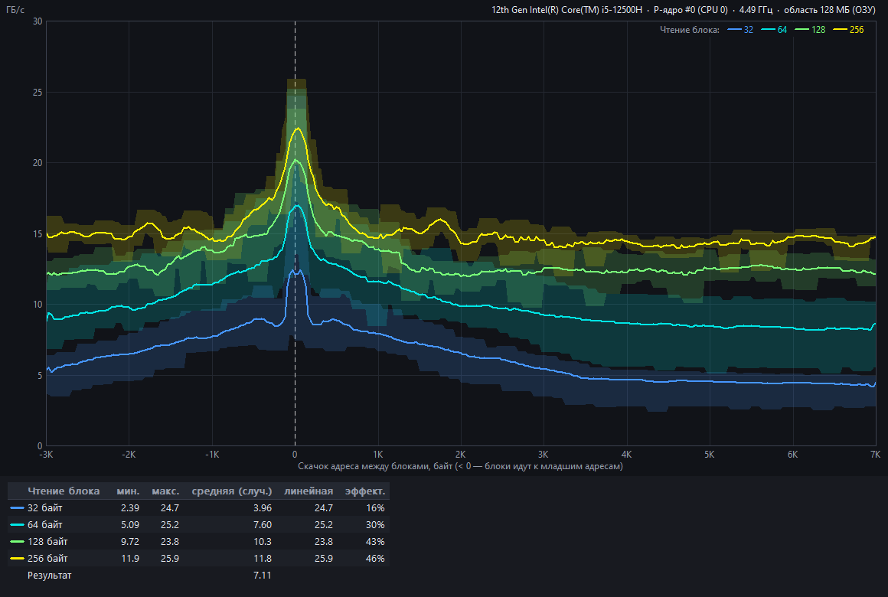
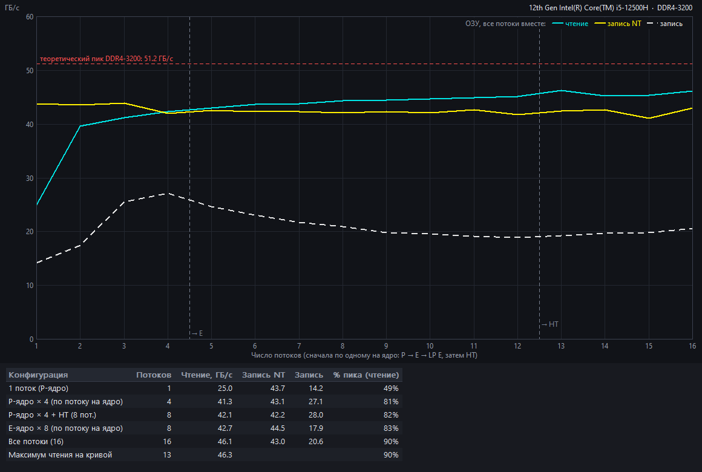

## Версии и тестирование

Номер версии задаётся в одном месте — `res/version.h`; что изменилось — в [CHANGELOG.md](CHANGELOG.md). Перед выпуском каждой версии прогоняется набор проверок:

```
powershell -ExecutionPolicy Bypass -File tests\run_tests.ps1          около 3 минут
powershell -ExecutionPolicy Bypass -File tests\run_tests.ps1 -Full    плюс полные замеры под эмуляцией
```

Он собирает программу и проверяет:
- что версия совпадает в exe, манифесте, README и CHANGELOG;
- что exe совместим с Windows 7 и что в общем коде нет AVX-команд;
- что железо всех 17 профилей эмуляции определяется так же, как в эталонах `tests/expected`;
- что 20 000 испорченных таблиц SMBIOS не приводят к падению;
- что полный прогон на этом ПК и прогоны с лимитом памяти 512 и 120 МБ дают правдоподобные цифры (кэш быстрее ОЗУ, задержки в разумных пределах, многопоток не выше теоретического пика).

Чужое железо проверяется эмуляцией: `tests\build_emu.bat` собирает `tests\BenchKrasulya_emu.exe` с ключом `-DBK_EMU`. В этой сборке CPUID, топология Windows (`GetLogicalProcessorInformationEx`) и таблица SMBIOS подменяются данными профиля в настоящем двоичном формате, а тесты реально выполняются на ядрах текущего ПК.

```
BenchKrasulya_emu.exe --emu-list list.txt                      список профилей
BenchKrasulya_emu.exe --emu ultra7-155h                        запуск с интерфейсом
BenchKrasulya_emu.exe --emu ultra7-155h --auto out --tests m   без интерфейса, результаты в out
BenchKrasulya_emu.exe --emu-fuzz 20000 fuzz.txt                испорченные таблицы SMBIOS
```

17 профилей: Core 2 + DDR2, Athlon 64 + DDR (SMBIOS 2.3, частота в МГц), i7-3770 + DDR3, i7-6700K с одним каналом, i9-13900K + DDR5 по 48 ГБ, Core Ultra 7 155H и 258V (LPDDR5X, LP E-ядра), Core Ultra 9 285K под Hyper-V, Ryzen 9 7950X (2 CCD), Ryzen AI 9 HX 370 (Zen 5 + Zen 5c), Threadripper 7980X (128 потоков, 2 группы процессоров), двухсокетный Xeon, N100, виртуальные машины без частоты и без SMBIOS, отказ топологии Windows, повреждённый SMBIOS.

Ещё проверялось:
- лимит памяти процесса (job object, 80–512 МБ) — тесты уменьшают буферы, многопоток честно пишет, сколько потоков поместилось;
- урезанная маска процессора (`start /affinity`);
- что в общем коде нет команд новее SSE2, а AVX/AVX-512 вызываются только после проверки CPUID и XCR0;
- что все импортируемые функции есть в Windows 7 SP1.

## Лицензия

MIT
